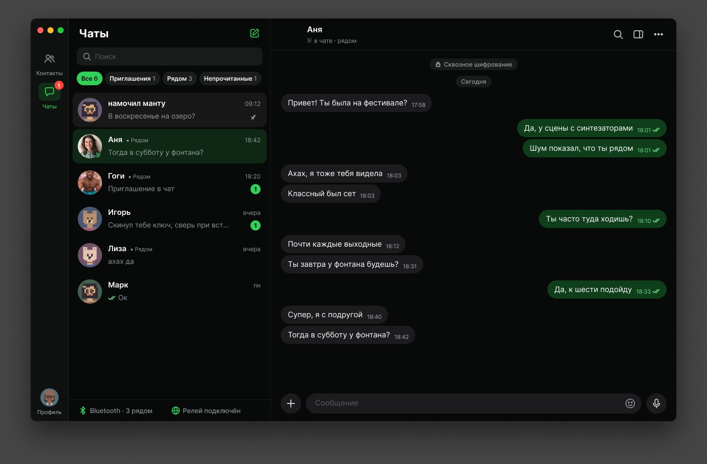
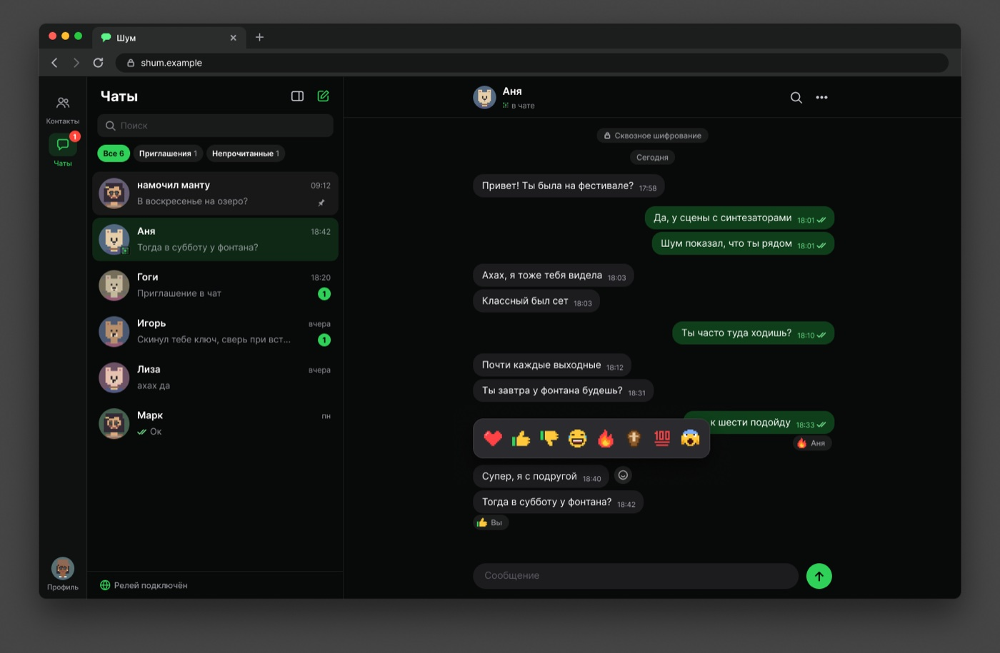

<p align="center">
  
</p>

<h1 align="center">Shum для компьютера и браузера</h1>

<p align="center">
  Чаты, контакты и люди рядом по Bluetooth на macOS, Windows и в браузере.<br>
  Тот же профиль, что на iPhone и в терминале.
</p>

<p align="center">
  <a href="https://github.com/hiTechTeam/Shum-App/releases/latest"></a>
  
  
  <a href="https://app.getshum.tech"></a>
</p>

<p align="center">
  <a href="README.md">English</a> · Русский
</p>

<p align="center">
  
</p>

## Установка

Бейдж выше показывает текущий релиз. Скачайте его в [Releases](https://github.com/hiTechTeam/Shum-App/releases/latest):

| Система | Файл |
| :--- | :--- |
| macOS 15+, Apple Silicon | `Shum-macOS.dmg` |
| Windows 10 и 11, x64 | `Shum-Windows-x64-setup.exe` |
| Windows 10 и 11, ARM64 | `Shum-Windows-arm64-setup.exe` |
| Linux | [Shum CLI](https://github.com/hiTechTeam/Shum-CLI) или [Shum Web](https://app.getshum.tech) |

* **macOS:** перенесите Shum в «Программы». Он подписан самоподписанным сертификатом и не заверен Apple: при первом запуске откройте «Системные настройки» → «Конфиденциальность и безопасность» и нажмите «Всё равно открыть».
* **Windows:** установщик не подписан. Если Windows напишет, что защитила компьютер, нажмите «Подробнее» → «Выполнить в любом случае». Права администратора не нужны.

Установленное приложение само обновляется до следующего релиза.

## Shum Web

<p align="center">
  
</p>

[app.getshum.tech](https://app.getshum.tech): тот же интерфейс в браузере, ничего не нужно устанавливать. Сообщения идут через релеи Nostr; для Bluetooth нужно приложение или телефон.

## Вместе с CLI

Приложение и [Shum CLI](https://github.com/hiTechTeam/Shum-CLI) видят одни и те же профили. Профиль на компьютере ведёт один процесс: если его уже открыла служба CLI, приложение подключается к ней, а если нет, приложение открывает профиль само, и тогда CLI подключается к приложению.

## Сборка

Интерфейс на React (`src`), оболочка на Tauri (`src-tauri`). Вся логика сообщений в [Shum-Core](https://github.com/hiTechTeam/Shum-Core), приложение её только показывает. Нужны Node.js 20+ и Rust stable.

```sh
npm install
npm run tauri dev
```

Сборка для разработки не может пользоваться Bluetooth: macOS приписывает его терминалу. Всё, что открывает профиль, проверяйте на собранном приложении:

```sh
sh scripts/package_macos.sh    # DMG, Apple Silicon
sh scripts/package_windows.sh  # установщики NSIS, сборка через cargo-xwin
npm run web:deploy             # Shum Web на app.getshum.tech
```

## Ещё

[getshum.tech](https://getshum.tech) · [iPhone](https://github.com/hiTechTeam/Shum-iOS) · [CLI](https://github.com/hiTechTeam/Shum-CLI) · [Ядро Rust](https://github.com/hiTechTeam/Shum-Core) · [Протокол](https://github.com/hiTechTeam/Shum-Protocol) · [Issues](https://github.com/hiTechTeam/Shum-App/issues)

## Лицензия

MIT
